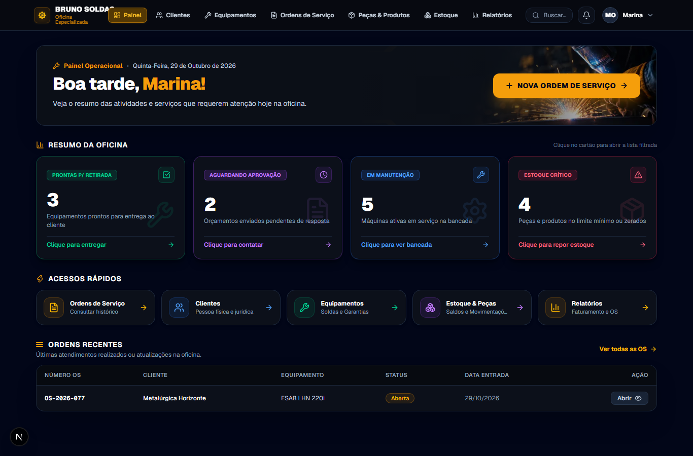
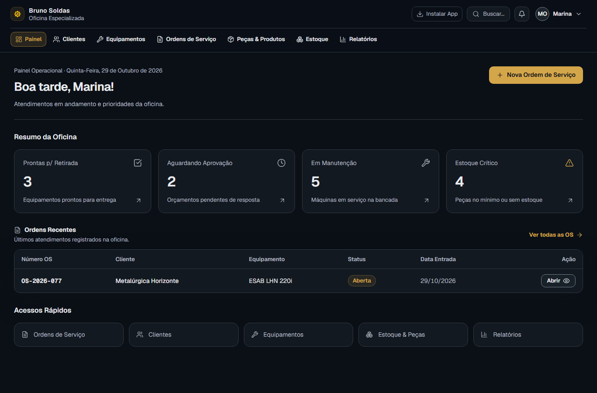
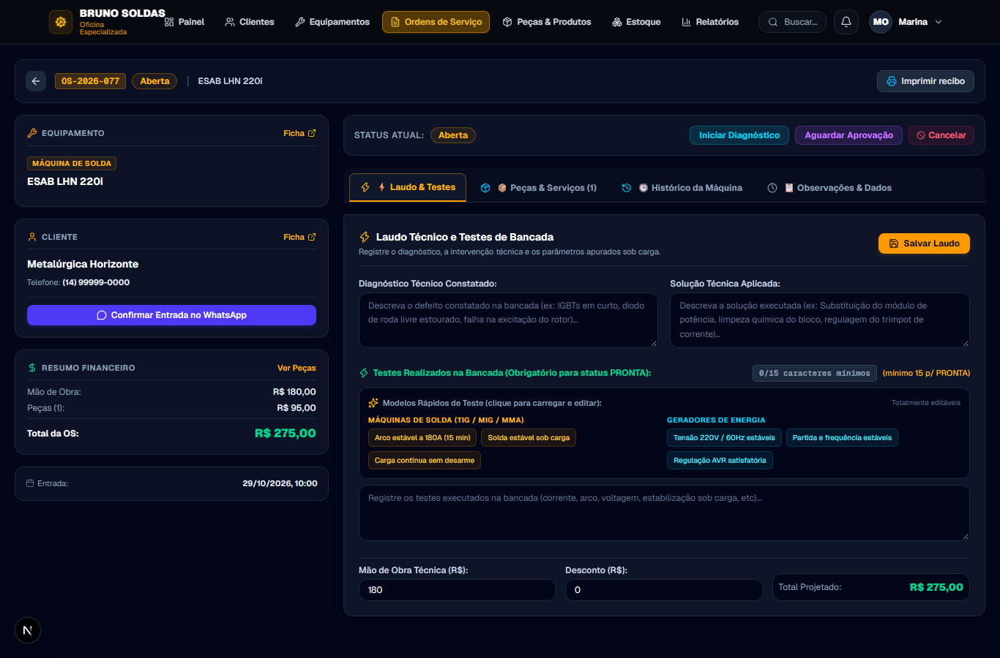
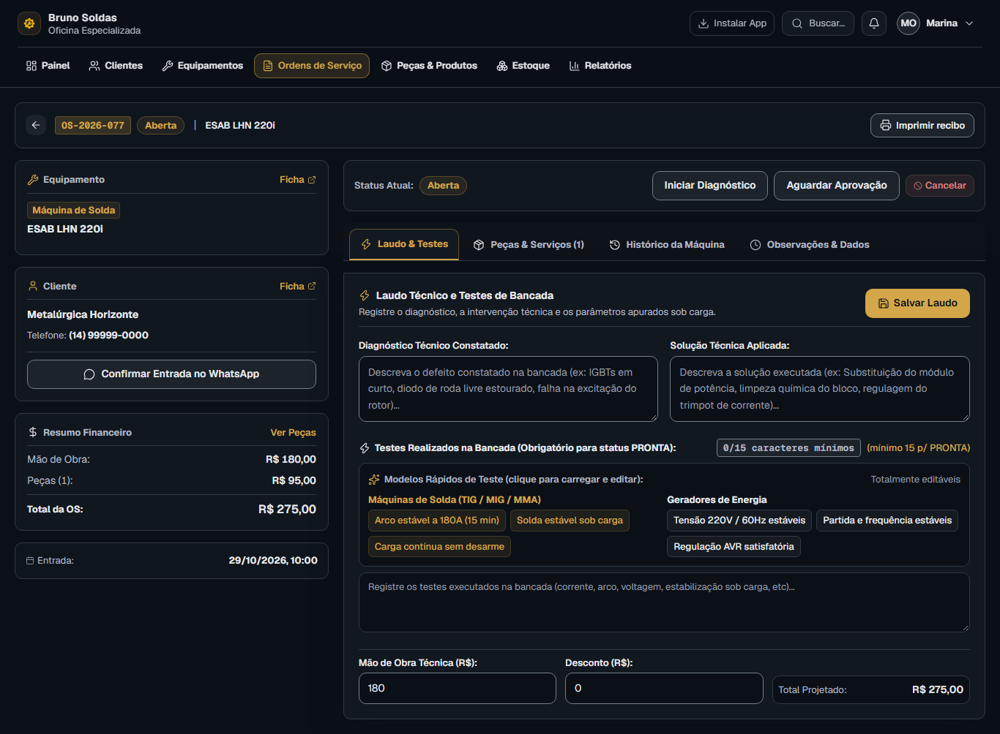

# Comparativo visual — Oficina Gestão

Capturas com dados sintéticos determinísticos, em 1366×900 e 390×900 (página inteira). Nenhum cadastro real aparece nas imagens. Os testes também verificam 360, 768, 1024 e 1920px, além da matriz existente de 320 a 2560px.

O baseline foi capturado no commit inicial `217cfe2`, antes da integração do PWA já existente na `main`. As imagens finais usam o build de produção e incluem o botão de instalação. A data, o usuário e os registros dos fixtures permanecem iguais.

| Tela | Antes desktop | Depois desktop | Antes mobile | Depois mobile |
| --- | --- | --- | --- | --- |
| Login | [1366px](before/login-1366.png) | [1366px](after/login-1366.png) | [390px](before/login-390.png) | [390px](after/login-390.png) |
| Dashboard | [1366px](before/dashboard-1366.png) | [1366px](after/dashboard-1366.png) | [390px](before/dashboard-390.png) | [390px](after/dashboard-390.png) |
| Clientes | [1366px](before/clientes-1366.png) | [1366px](after/clientes-1366.png) | [390px](before/clientes-390.png) | [390px](after/clientes-390.png) |
| Cliente — detalhe | [1366px](before/cliente-1366.png) | [1366px](after/cliente-1366.png) | [390px](before/cliente-390.png) | [390px](after/cliente-390.png) |
| Equipamentos | [1366px](before/maquinas-1366.png) | [1366px](after/maquinas-1366.png) | [390px](before/maquinas-390.png) | [390px](after/maquinas-390.png) |
| Equipamento — detalhe | [1366px](before/maquina-1366.png) | [1366px](after/maquina-1366.png) | [390px](before/maquina-390.png) | [390px](after/maquina-390.png) |
| Ordens de serviço | [1366px](before/ordens-1366.png) | [1366px](after/ordens-1366.png) | [390px](before/ordens-390.png) | [390px](after/ordens-390.png) |
| Nova OS | [1366px](before/nova-os-1366.png) | [1366px](after/nova-os-1366.png) | [390px](before/nova-os-390.png) | [390px](after/nova-os-390.png) |
| OS — operação | [1366px](before/ordem-1366.png) | [1366px](after/ordem-1366.png) | [390px](before/ordem-390.png) | [390px](after/ordem-390.png) |
| Peças e produtos | [1366px](before/produtos-1366.png) | [1366px](after/produtos-1366.png) | [390px](before/produtos-390.png) | [390px](after/produtos-390.png) |
| Estoque | [1366px](before/estoque-1366.png) | [1366px](after/estoque-1366.png) | [390px](before/estoque-390.png) | [390px](after/estoque-390.png) |
| Movimentações | [1366px](before/movimentacoes-1366.png) | [1366px](after/movimentacoes-1366.png) | [390px](before/movimentacoes-390.png) | [390px](after/movimentacoes-390.png) |
| Relatórios | [1366px](before/relatorios-1366.png) | [1366px](after/relatorios-1366.png) | [390px](before/relatorios-390.png) | [390px](after/relatorios-390.png) |
| Configurações | [1366px](before/configuracoes-1366.png) | [1366px](after/configuracoes-1366.png) | [390px](before/configuracoes-390.png) | [390px](after/configuracoes-390.png) |

## Diálogos finais

| Diálogo | Desktop | Mobile |
| --- | --- | --- |
| Cliente | [1366px](after/cliente-modal-1366.png) | [390px](after/cliente-modal-390.png) |
| Equipamento | [1366px](after/maquina-modal-1366.png) | [390px](after/maquina-modal-390.png) |
| Produto | [1366px](after/produto-modal-1366.png) | [390px](after/produto-modal-390.png) |
| Compatibilidade | [1366px](after/compatibilidade-modal-1366.png) | [390px](after/compatibilidade-modal-390.png) |
| Movimentação | [1366px](after/movimentacao-modal-1366.png) | [390px](after/movimentacao-modal-390.png) |
| Confirmação | [1366px](after/confirmacao-modal-1366.png) | [390px](after/confirmacao-modal-390.png) |
| Busca rápida | [1366px](after/busca-modal-1366.png) | [390px](after/busca-modal-390.png) |
| Instalação PWA | [1366px](after/instalacao-modal-1366.png) | [390px](after/instalacao-modal-390.png) |
| Transição de status | [1366px](after/status-modal-1366.png) | [390px](after/status-modal-390.png) |
| Adicionar peça à OS | [1366px](after/peca-modal-1366.png) | [390px](after/peca-modal-390.png) |

## Exemplos

### Dashboard

Antes:

Depois:

### Operação de OS

Antes:

Depois:

## Reproduzir

Na pasta `frontend`, execute `npx playwright test e2e/visual-review.spec.ts e2e/visual-interactions.spec.ts`. O servidor de teste usa o build de produção quando não há servidor local ativo. Para uma nova referência anterior, use `VISUAL_PHASE=before` no checkout de origem; não sobrescreva o baseline com código novo.
